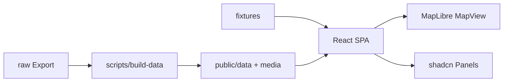

# Road to Athen – Umsetzungsplan

Nichts spricht gegen eine **statische Seite**: Brief und Stack sind dafür ausgelegt (kein Backend, Daten einmal vorbereiten, `dist/` hosten). SPA-Routing braucht beim Deploy nur SPA-Fallback (`/*` → `index.html`).

**Festlegungen:** React Router · npm · Entwicklung mit `VITE_USE_FIXTURES=true` · Pipeline schreibt du selbst · Hosting = beliebiger Static Host (Vercel/Netlify/Cloudflare Pages) ohne Anbieter-Config in Phase 0–5.

**Voraussetzung vor Phase 0:** Node ≥ 20.19 (aktuell 18.13 – z. B. `brew install node@22`). ffmpeg und exiftool sind vorhanden. Kit-Dateien (`.cursor/`, `.cursorignore`, `.gitignore.append`) sind im Projekt.

---

## Standard-Design (Figma + Griechenland)

Quelle: [Figma – Road to Athen](https://www.figma.com/design/st7dsTvk8dARt1wCM3N9zY/Untitled?node-id=1-3) (Node `1:3`). Ersetzt Terrakotta/Fraunces/Papier. Layout aus dem Brief bleibt; Tokens und Typo folgen Figma.

**Leitidee:** Griechenland-Anmutung – **kräftiges Blau + Weiß** als Primärpaar (Flagge/Ägäis), UI minimal, eine Sans-Familie. **Großzügiges Spacing**, harte Kanten (`radius: 0`). Kein Terrakotta, kein warmes Papier, keine abgerundeten Cards/Buttons.

| Rolle | Wert | Token |
|---|---|---|
| Primary / Route / Akzent | `#1f26f0` | `--primary`, `--route`, `--ring` |
| Flächen / Panels | `#ffffff` | `--background`, `--card`, `--popover` |
| Text | kühles Fast-Schwarz | `--foreground` |
| Nebentext | kühles Grau | `--muted-foreground` |
| Route blass / Kontur | Blau mit Alpha / Weiß | `--route-muted`, `--route-casing` |
| Etappenende | dunkleres Blau (gleiche Familie) | `--stage-end` |
| Ziel Athen | etwas helleres/kräftigeres Blau (kein Gold) | `--finish` |
| Brand + UI-Schrift | **Uncut Sans Variable** (wght für Bold/Regular) | `--font-sans` und `--font-heading` = dieselbe Familie |
| Eckenradius | **`0px` überall** | `--radius: 0` (kein `rounded-xl` / `rounded-md` als Default) |
| Spacing | **weit / luftig** | Panel-Innenabstand eher `p-6 md:p-8` (statt engem `p-4`); großzügige Gaps zwischen Liste, Stats, Karte; Thumbnail-Marker behalten klaren Weißrand, aber eckig |

**Font (vorhanden):** [design/fonts/UncutSans-Variable.ttf](design/fonts/UncutSans-Variable.ttf) – in Phase 0 per `@font-face` mit `font-weight: 100 900` einbinden, nach `src/assets/fonts/` kopieren oder von dort referenzieren. Kein CDN, kein Fraunces/Inter.

**Form & Raum (verbindlich ab Phase 0):**
- `--radius: 0` in Tokens und shadcn-Base; Komponenten nicht nachträglich abrunden
- Viel Weißraum: Sections und Panels mit großem Padding; Sidebar/Drawer nicht „dicht“
- Foto-Marker und Cluster ebenfalls eckig (`rounded-none`), nicht pillenförmig

**Umsetzung in Phase 0 (Priorität Farbe + Font + Radius/Spacing):**
- [x] [design/tokens.css](design/tokens.css), [docs/DESIGN_SYSTEM.md](docs/DESIGN_SYSTEM.md), [design/map-theme.ts](design/map-theme.ts) auf Blau/Weiß + Uncut Sans + `--radius: 0` + luftiges Spacing umschreiben
- [x] Tokens nach shadcn-Init in `src/index.css`; Map-Hex `route: "#1f26f0"`
- [x] `@font-face` für `UncutSans-Variable.ttf`; `font-heading` und `font-sans` darauf legen; Brand mit `font-weight: 700` + engem Tracking
- [x] Brand-Check: Titel „Road to Athen“ Bold + `#1f26f0` auf Weiß (wie Figma); Panels eckig und großzügig gepaddet
- [x] Optional später: Figma-Routen-SVG als Logo – kein Blocker

---

## Phase 0 – Grundgerüst

**Ziel:** Lauffähiges Vite+React+TS-Projekt im aktuellen Ordner (Docs/Design/raw behalten), **Figma-Designsystem** aktiv, leeres Layout mit Router.

**Aufgaben**

- [x] Node ≥ 20.19 prüfen (`node -v`)
- [x] Vite React-TS im aktuellen Ordner anlegen (vorhandene Dateien behalten, nicht überschreiben)
- [x] Tailwind CSS v4 + shadcn/ui initialisieren (`npx shadcn@latest init`)
- [x] Design-Docs/Tokens auf Figma umstellen (siehe Abschnitt oben), dann in `src/index.css` übernehmen (`:root`, `.dark` optional vereinfacht, `@theme inline` inkl. Route-/Map-Tokens)
- [x] Uncut Sans aus `design/fonts/UncutSans-Variable.ttf` einbinden (Variable-Achse für Bold/Regular) – **nicht** Fraunces/Inter
- [x] [design/map-theme.ts](design/map-theme.ts) → `src/lib/map-theme.ts` mit Hex `#1f26f0` und kühlem Hillshade (zu Blau/Weiß passend)
- [x] shadcn-Komponenten installieren: `button card badge separator scroll-area sheet drawer dialog carousel tooltip skeleton chart toggle-group`
- [x] React Router: `/` und `/etappe/:nr` (Platzhalter-Seiten)
- [x] Ordner laut Regel `00-projekt.mdc`: `src/components/`, `src/features/map/`, `src/lib/`, `src/routes/`, `src/types/`, `scripts/`, `fixtures/`
- [x] `.gitignore` um Inhalt von `.gitignore.append` ergänzen (`raw/`, `public/data/`, `public/media/`)
- [x] Git: Repo existiert bereits – Status sauber; Kit-Dateien + Scaffold committen nur auf Wunsch
- [x] README kurz: Dev-Start, Node-Version, Fixtures, Font-Lizenzhinweis

**Neue Dateien/Ordner:** `package.json`, `vite.config.ts`, `src/**`, `index.html`, `components.json`, `src/lib/map-theme.ts`, Font-Referenz auf bestehendes `design/fonts/`, leere `fixtures/`, `scripts/`

**npm-Pakete**

- Vite, React, TypeScript, Tailwind v4 – Build/UI
- `shadcn` / Radix-Peer-Deps – Komponenten
- `react-router` – URLs `/` und `/etappe/:nr`
- Kein `@fontsource`; Uncut Sans nur lokal aus `design/fonts/`

**Browser-Check:** `npm run dev` → weißer Hintergrund, Titel in Uncut Sans Bold und Blau `#1f26f0`, **eckige** Panels (`radius 0`) mit **großzügigem** Padding, Navigation `/` ↔ `/etappe/1` ohne Fehler. `npm run build` + `npm run lint` grün.

---

## Phase 1 – Datenpipeline + Fixtures

**Ziel:** Scripts erzeugen `public/data` + `public/media`; App kann Fixtures laden. Pipeline **nicht** vom Agenten ausführen.

**Aufgaben**

- [x] `src/types/data.ts` laut [docs/DATA_SPEC.md](docs/DATA_SPEC.md)
- [x] `scripts/config.ts` (`PRIVACY_TRIM_METERS` = 300, Pfade, Toleranzen)
- [x] `scripts/build-data.ts` (tsx): CSV → FIT → GeoJSON/JSON; Medien → WebP/MP4; idempotent + `--force`
- [x] CSV mit `csv-parse`, Spalten **per Index**; Medien aus Spalte 102; fehlende Dateien loggen
- [x] FIT via `@garmin/fitsdk` + gunzip; Semicircles → Grad; `@turf/simplify`; Höhenprofil ~300 Punkte; TZ via `@photostructure/tz-lookup`
- [x] Fotos: `sharp` (thumb 160 / medium 1600 WebP); Videos: `ffmpeg` 720p + Poster; keine EXIF in Ausgabe-Logs
- [x] Optional `raw/media.csv` für `caption`, falls vorhanden (sonst weglassen)
- [x] Ausgabe: `stages.json`, `overview.geojson`, `stages/<nr>.json`, `media.json`, `public/media/...`
- [x] `fixtures/` mit 3 erfundenen Etappen + ~10 Platzhalter-Medien (Griechenland-Koordinaten)
- [x] `VITE_USE_FIXTURES=true` schaltet Datenroot auf Fixtures
- [x] npm-Script `build:data`

**Neue Dateien:** `scripts/build-data.ts`, `scripts/config.ts`, `scripts/lib/*`, `fixtures/data/`**, `fixtures/media/**`, `src/types/data.ts`, `src/lib/data.ts` (Loader)

**npm-Pakete (dev):** `tsx`, `csv-parse`, `@garmin/fitsdk`, `@turf/simplify`, `@photostructure/tz-lookup`, `sharp`, `exifr`, `exiftool-vendored`, `@types/geojson`

**Browser-Check:** Mit Fixtures: Overview-JSON und eine Stage-Detail-JSON in der UI oder Console sichtbar. Echte Pipeline: du startest `npm run build:data`, meldest nur Zahlen an den Agenten.

---

## Phase 2 – Karte (Überblick)

**Ziel:** MapLibre + OpenFreeMap + Mapterhorn-Hillshade; alle Etappenlinien; Start/Etappenenden/Ziel; fitBounds Gesamtstrecke.

**Aufgaben**

- [x] `react-map-gl/maplibre` + `maplibre-gl` CSS; Map-Instanz einmalig (`useMap`)
- [x] Stil `mapSources.baseStyle`; DEM + Hillshade unter Straßen/Labels (`encoding: "terrarium"`)
- [x] Attribution sichtbar (OpenFreeMap/OSM + Mapterhorn)
- [x] `overview.geojson`: muted Linien, Stage-End-Circles, Start + Finish (Finish hervorgehoben)
- [x] Farben/Breiten aus `src/lib/map-theme.ts`
- [x] Start: `fitBounds` mit Padding für Panel
- [x] Gesamtstatistik-Panel (Tage, km, Höhenmeter, Fotos) aus `stages.json`

**Neue Dateien:** `src/features/map/MapView.tsx`, Layer-/Hook-Dateien, `src/routes/OverviewPage.tsx`

**npm-Pakete:** `maplibre-gl`, `react-map-gl` – Karte ohne API-Key

**Browser-Check (`VITE_USE_FIXTURES=true`):** Relief sichtbar, 3 Linien + Punkte, Start/Ziel unterscheidbar, Attribution, Overview zoomt auf alles.

---

## Phase 3 – Etappen-Navigation

**Ziel:** Liste, Deep-Links, Highlight, Kartenflug, Etappen-Statistik.

**Aufgaben**

- [x] Desktop: `ScrollArea`-Sidebar; Mobile: `Drawer` Bottom Sheet
- [x] Liste: Tag, Name, Datum, km, Höhenmeter; aktive Etappe markiert
- [x] `/etappe/:nr` lädt `stages/<nr>.json` on demand; Zurück/Weiter + Pfeiltasten; an Rändern disabled
- [x] Aktive Linie `--route` + Casing; andere `--route-muted` (filter/feature-state, Quellen nicht neu erzeugen)
- [x] `fitBounds(bbox, { duration: 1200, padding })`
- [x] Stats-Card: Distanz, Höhenmeter, Bewegungszeit, Ø-Speed, Start Ortszeit (`Intl` + `timeZone`), Ø-Temp

**Neue Dateien:** `StageList`, `StageNav`, `StageStats`, `StagePage`, Format-Helfer in `src/lib/`

**npm-Pakete:** keine neuen (Router + shadcn reichen)

**Browser-Check:** Direkt-URL `/etappe/2`; Tastatur; Mobile Drawer; Highlight + Flug; Stats plausibel.

---

## Phase 4 – Medien

**Ziel:** Thumbnails auf der Route, Cluster im Überblick, Lightbox, Fotoleiste.

**Aufgaben**

- [x] Overview: GeoJSON-Cluster (Badge + erstes Thumb)
- [x] Stage: HTML-Marker 40×40 nur mit Position; max. ~50 im DOM; Videos mit Play-Icon
- [x] `lat/lng === null` nie auf Karte (nur Lightbox + Leiste)
- [x] Lightbox: `Dialog` + `Carousel`, zeitlich sortiert, Video abspielbar
- [x] Horizontale Fotoleiste; Klick → Karte zentrieren + aktiver Marker
- [x] Alt-Texte: „Foto Etappe N, HH:MM Uhr“

**Neue Dateien:** `MediaMarker`, `MediaClusterLayer`, `MediaLightbox`, `MediaStrip`; Fixtures-Medien nutzen

**npm-Pakete:** keine neuen (ggf. später `@vis.gl`-Cluster nur wenn nötig – Prefer MapLibre native `cluster`)

**Browser-Check:** Cluster im Überblick; in Etappe Thumbs an Linie; Lightbox blättert inkl. Video; Medien ohne GPS nur in Leiste/Lightbox.

---

## Phase 5 – Höhenprofil + Feinschliff

**Ziel:** Profil-Chart gekoppelt an Karte; Mobile; Performance; A11y.

**Aufgaben**

- [x] shadcn Chart (Recharts Area) aus `profile`
- [x] Hover → Punkt auf Linie (eigene circle-Quelle, kein Map-Re-Render)
- [x] Mobile Layout/Bottom Sheet; Lade-Skeletons; Tastatur in Lightbox/Liste
- [x] Overview lädt nur vereinfachte Linie; Detailspuren lazy
- [x] Ziel <3 s bis sichtbare Karte auf typischem Handy (Netzwerk-Tab prüfen)

**Neue Dateien:** `ElevationProfile.tsx`, Feinschliff an bestehenden Map/UI-Komponenten

**npm-Pakete:** Recharts (via shadcn chart) – falls noch nicht durch `chart`-Add

**Browser-Check:** Hover sync; Mobile 375px; Keyboard; Lighthouse/Network grob ok.

---

## Phase 6 – Veröffentlichen

**Ziel:** Produktions-Build, Größen prüfen, Static Deploy.

**Aufgaben**

- [x] `npm run build` → `dist/`; Asset-Größen und große Videos prüfen (Pipeline-Log)
- [x] SPA-Fallback beim Host konfigurieren
- [x] Echte Daten: `build:data`, Privacy-Trim prüfen, kein Commit von `raw/` / `public/media`
- [x] Deploy `dist/` (Drag&Drop oder Git-Connect); Smoke-Test Overview + Deep-Link + Lightbox
- [x] Attribution und Alt-Texte final checken

**Neue Dateien:** ggf. `public/_redirects` (Netlify) oder `vercel.json` / `public/_routes.json` – erst wenn Anbieter feststeht

**npm-Pakete:** keine

**Browser-Check:** Live-URL: Start <3 s Karte, alle Etappen, Medien, Attribution.

---

## UI Shell v2 – Sidebar + Scrub-Timeline

**Ziel:** Etappenliste aus der Sidebar entfernen; Facts/Etappen-Detail in der einklappbaren Sidebar; kontinuierlich scrubbare Timeline unten über der Karte mit Freilauf-Sound und Karten-Follow.

**Aufgaben**

- [x] AppShell: collapsible Sidebar, Panel nur Sidebar, Timeline-Slot unten mittig
- [x] `StageTimeline`: distanzproportionale Tages-Ticks, Playhead-Scrub
- [x] `route-progress` + MapView `followPoint` entlang Overview-Polyline
- [x] Freilauf-Sound `public/audio/freewheel.mp3` + Retrigger beim Scrub
- [x] OverviewPage / StagePage umverdrahten; StageList/StageNav entfernt
- [x] Build + Lint fehlerfrei

**Browser-Check:** `/` → Sidebar Facts; Timeline draggen → Karte folgt + Klicks; Loslassen → `/etappe/n` + Detail in Sidebar; Sidebar einklappen; Mobile Drawer.

---

## Architektur (kurz)

---

## Risiken und offene Fragen

**Risiken**

- Node 18 blockiert Vite – vor Phase 0 upgraden
- Starkes Blau `#1f26f0` auf der Karte kann bei Hillshade/Positron dominant wirken – Kontrast muted Route/Marker in Phase 2 feinjustieren
- Uncut Sans liegt bereit (`design/fonts/UncutSans-Variable.ttf`); Lizenz liegt bei dir – Datei mit committen oder nur lokal halten, je nach Lizenzbedingungen
- `public/media` ~200–300 MB; Cloudflare Pages 25 MB/Datei – große Videos vor Deploy prüfen
- OpenFreeMap/Mapterhorn-Verfügbarkeit; Hillshade ohne `terrarium` wirkt „flach/falsch“
- CSV-Doppelspalten nur per Index korrekt
- 3D/Dark Mode/Autoplay bewusst später (Kann-Liste)
- Alte Docs (`DESIGN_SYSTEM.md` Terrakotta) und Regeltexte können Agenten verwirren, bis Phase 0 sie aktualisiert

**Offene Fragen**

- Welcher Static-Host genau? (erst Phase 6 nötig)
- `PRIVACY_TRIM_METERS` 300 ausreichend?
- `media.csv` für Captions nutzen, sobald in `raw/` liegt?
- Darf `UncutSans-Variable.ttf` ins Git (öffentlich), oder nur lokal / über Deploy-Secrets?